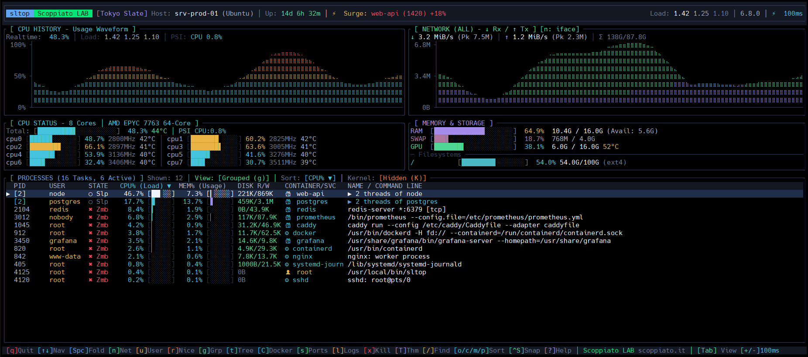

<p align="center">
  
</p>

<h1 align="center">sltop</h1>

<p align="center">
  <strong>Lightweight terminal system monitor for Linux written in Rust</strong><br>
  Crafted & Maintained by <a href="https://scoppiato.it"><strong>Scoppiato LAB</strong></a>
</p>

<p align="center">
  <a href="https://scoppiato.it"></a>
  <a href="https://discord.scoppiato.it"></a>
  <a href="https://crates.io/crates/sltop"></a>
  <a href="https://github.com/Scoppiato-LAB/SLTOP/releases"></a>
  <a href="LICENSE"></a>
</p>

<p align="center">
  
  
  
  <a href="https://crates.io/crates/sltop"></a>
</p>

<p align="center">
  
  
  
  
  
  
  
  
</p>

---

## Overview

**sltop** is an ultra-lightweight, real-time terminal system monitor designed for Linux servers and development environments. Built from the ground up in Rust, it delivers live hardware telemetry, high-resolution Braille graphs, container cgroup resolution, and process management with near-zero CPU and memory footprint.

<p align="center">
  
</p>

---

## Features

- **Braille Waveform Graphs**: 2×4 Braille sub-character rendering for historical CPU dynamics and network bandwidth (Rx/Tx) grounded cleanly on continuous 0% / 0B baseline axes.
- **Container & Service Awareness**: Resolves Linux cgroups directly to identify Docker container names and systemd service units for every process.
- **Linux PSI Telemetry**: Real-time Pressure Stall Information tracking resource starvation across CPU, memory, and I/O subsystems.
- **Kernel Socket & Port Inspection**: Inspects active TCP socket tables and listening ports without spawning external utilities.
- **Interactive Process Controls**: Send signals (`SIGTERM`/`SIGKILL`), adjust scheduling priorities (`renice`), and fold/unfold process groups or tree hierarchies.
- **Embedded Log Streamer**: Live journal tailing (`journalctl -u`) and Docker container log streaming (`docker logs`) directly from the selected process.
- **Minimal Resource Footprint**: Optimized with Link-Time Optimization (`LTO = fat`) and binary stripping into a compact standalone binary (~1.1 MB).
- **Multiple Color Themes**: Tokyo Slate, Catppuccin Mocha, Gruvbox Dark, Nordic Frost, and Monokai Minimal.

---

## Installation

### Quick Install (Linux & macOS)

Install the latest pre-compiled standalone binary with a single command:

```bash
curl -fsSL https://raw.githubusercontent.com/Scoppiato-LAB/SLTOP/main/install.sh | sudo bash
```

---

### Package Managers

#### ⚡ Canonical Snap Store (Universal Linux)
Available for all Linux distributions with snap support (Ubuntu, Debian, Fedora, Arch, openSUSE, etc.):
```bash
sudo snap install sltop
```

#### 📦 Debian, Ubuntu, Proxmox VE (APT Repository & .deb)
Add the Scoppiato LAB APT repository to receive automatic updates with `apt upgrade`:
```bash
curl -fsSL https://raw.githubusercontent.com/Scoppiato-LAB/SLTOP/main/setup-apt.sh | sudo bash
sudo apt install sltop
```
Or install the standalone `.deb` package directly from [Releases](https://github.com/Scoppiato-LAB/SLTOP/releases):
```bash
sudo apt install ./sltop-amd64.deb
```

#### 🎩 Fedora, RHEL, CentOS, Rocky Linux (Copr & DNF / .rpm)
Enable the official Scoppiato LAB Copr repository:
```bash
sudo dnf copr enable Scoppiato-LAB/sltop
sudo dnf install sltop
```
Or install the standalone `.rpm` package directly:
```bash
sudo dnf install ./sltop-amd64.rpm
# or
sudo rpm -ivh sltop-amd64.rpm
```

#### 🍏 macOS & Linux (Homebrew)
Via the official Scoppiato LAB Tap:
```bash
brew install Scoppiato-LAB/tap/sltop
```

#### 🪟 Windows (Winget & Scoop)
Via Windows Package Manager:
```powershell
winget install ScoppiatoLAB.sltop
```
Via Scoop:
```powershell
scoop install sltop
```

#### 🐧 Arch Linux (AUR)
```bash
yay -S sltop-bin
```

#### 🦀 Cargo (Crates.io)
```bash
cargo install sltop
```

---

### From Source

Requires a working [Rust](https://www.rust-lang.org/) toolchain (1.74+):

```bash
git clone https://github.com/Scoppiato-LAB/SLTOP.git
cd SLTOP
cargo build --release
sudo install -m 755 target/release/sltop /usr/local/bin/
```

Run `sltop`:
```bash
sltop
```

---

## Keybindings

### Navigation & Views

| Key | Description |
| :--- | :--- |
| `↑` / `k`, `↓` / `j` | Move selection up / down |
| `PgUp` / `PgDn` | Jump 10 items |
| `Home` / `End` | Jump to beginning / end |
| `C` | Toggle Container View (group by Docker container / systemd service) |
| `g` | Toggle Process Grouping |
| `t` | Toggle Tree View (parent-child hierarchy) |
| `Space` | Expand / collapse group or tree branch |
| `u` | Filter processes by user |
| `/` | Search filter (name, PID, user, command line, container) |
| `K` | Toggle kernel thread visibility |
| `Tab` | Switch view layout (Balanced / Process Focus / Graph Focus) |

### Process Management & Diagnostics

| Key | Description |
| :--- | :--- |
| `Enter` | Show process details inspector |
| `s` | View open sockets and listening ports |
| `l` | View live process / container logs |
| `e` | View environment variables |
| `r` | Adjust process scheduling priority (`renice`) |
| `[` / `]` | Quick decrease / increase nice priority |
| `x` / `Delete` | Kill process dialog (`t` = SIGTERM, `k` = SIGKILL) |
| `n` | Cycle network interface (`ALL`, `eth0`, `docker0`, etc.) |
| `T` | Cycle color themes |
| `+` / `-` | Adjust sampling interval (100ms - 5000ms) |
| `Ctrl+S` / `F2` | Export complete telemetry snapshot to JSON file |
| `Ctrl+P` | Save current preferences to `~/.config/sltop/sltop.toml` |
| `?` / `h` | Open help & keybindings overlay |
| `q` / `Esc` | Close modal / Exit |

---

## Headless & Automation Options

`sltop` can run non-interactively for server audits, metrics collection, or scripts:

```bash
# Print a plain text snapshot to stdout and exit
sltop --snapshot

# Output complete system telemetry in JSON format
sltop --json

# Override sampling interval
sltop --interval 250
```

---

## Configuration

Settings are saved automatically via `Ctrl+P` or can be edited in `~/.config/sltop/sltop.toml`:

```toml
sample_interval_ms = 100
theme = "tokyo_slate"
sort_by = "cpu"
sort_order = "desc"
view_mode = "balanced"
process_view_type = "container"
hide_kernel_threads = true
```

---

## Community & About Scoppiato LAB

**sltop** is an open-source project proudly developed and maintained by **Scoppiato LAB**.

- 🌐 **Official Website**: [https://scoppiato.it](https://scoppiato.it)
- 💬 **Discord Community**: [https://discord.scoppiato.it](https://discord.scoppiato.it)
- 📦 **GitHub**: [https://github.com/Scoppiato-LAB/SLTOP](https://github.com/Scoppiato-LAB/SLTOP)

Join our Discord server for support, feature discussions, and updates on our open-source tools!

---

## License

This project is licensed under the MIT License - see the [LICENSE](LICENSE) file for details.

Copyright (c) 2026 **Scoppiato LAB** ([https://scoppiato.it](https://scoppiato.it)).
